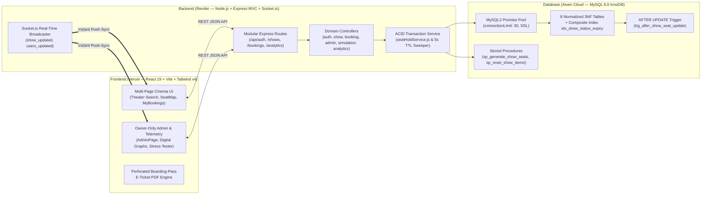
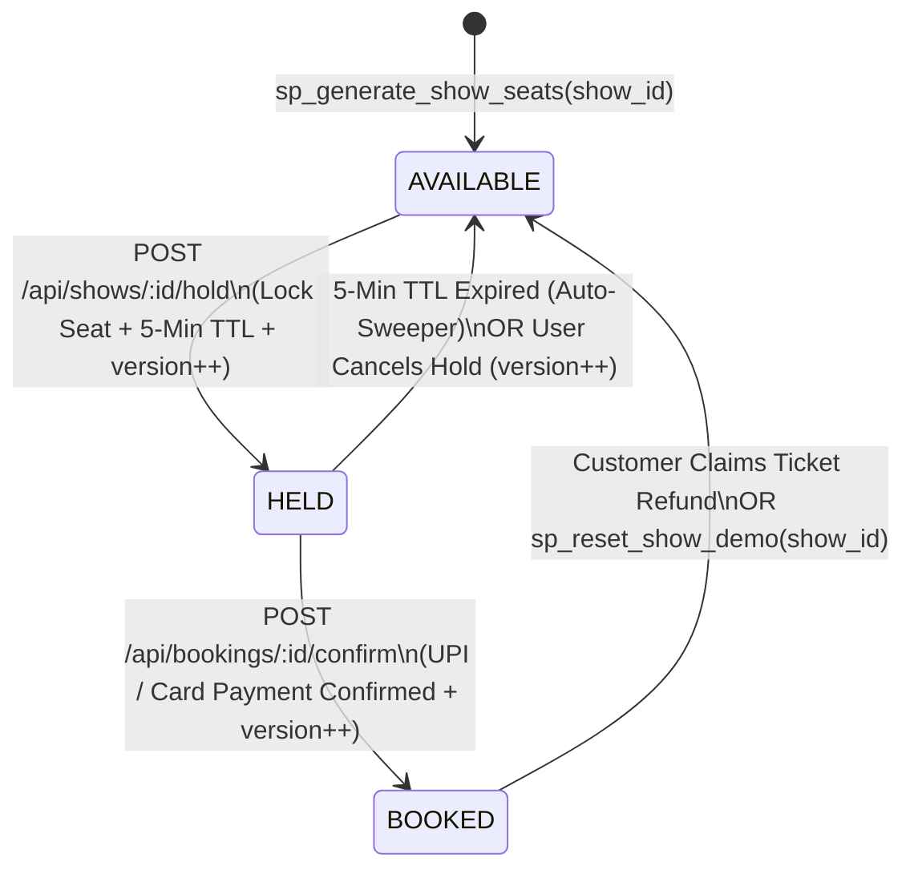
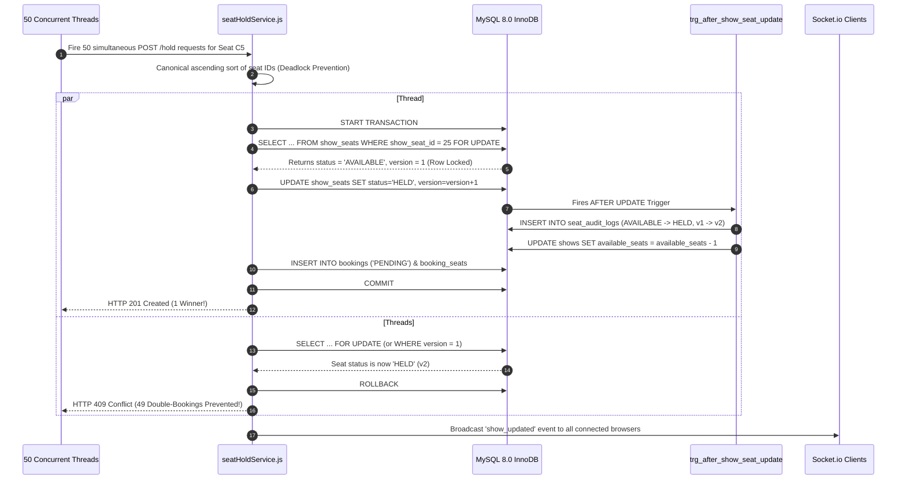
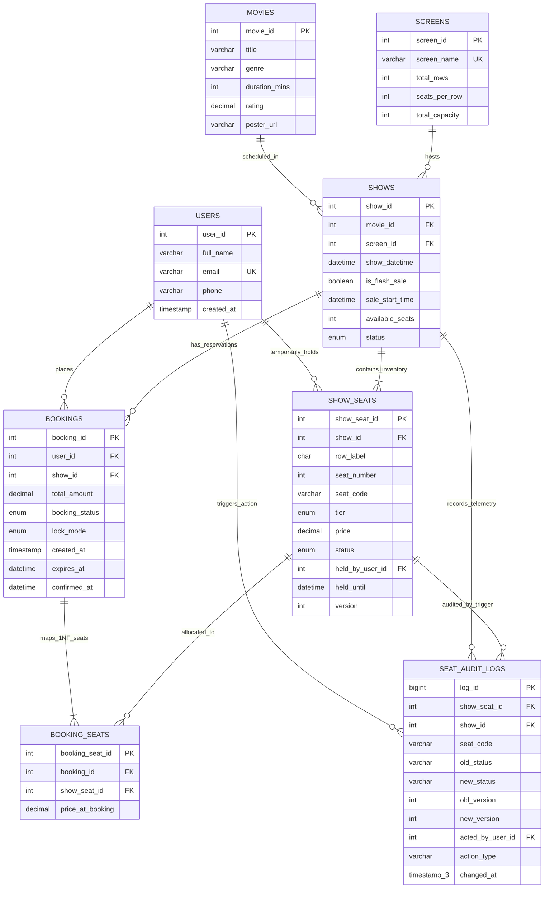

# 🎬 High-Concurrency Movie Flash-Sale & Seat Reservation Management System

[](https://dbms-capstone-project-ebon.vercel.app)
[](https://high-concurrency-movie-flash-sale-and.onrender.com/api/shows)
[](https://aiven.io)
[](https://github.com/anshverma004/DBMS_Capstone_Project)

> **B.Tech CSE (AI & ML) — 3rd Semester Database Management Systems (DBMS) Capstone Project**  
> **University:** K.R. Mangalam University  
> **Author / Owner:** Ansh Verma (`anshverma004`)  

A production-deployed, full-stack **High-Concurrency Movie Flash-Sale & Seat Reservation Management System** inspired by **BookMyShow**. Built from the ground up on **MySQL 8.0 (`InnoDB` transactional storage engine)**, **Node.js + Express (Modular Service-Controller MVC)**, **Socket.io**, and **React + Vite + Tailwind CSS v4** to eliminate double-bookings, race conditions, deadlocks, and abandoned-cart inventory lockups during high-traffic blockbuster ticket drops.

---

## 🌐 Live Cloud Deployment

| Layer | Hosting Provider | Live URL |
| :--- | :--- | :--- |
| **Frontend Web App** | **Vercel** | [https://dbms-capstone-project-ebon.vercel.app](https://dbms-capstone-project-ebon.vercel.app) |
| **Backend REST + WebSocket API** | **Render** | [https://high-concurrency-movie-flash-sale-and.onrender.com/api/shows](https://high-concurrency-movie-flash-sale-and.onrender.com/api/shows) |
| **Cloud Relational Database** | **Aiven Cloud MySQL 8.0** | Managed `InnoDB` Cluster with TLS/SSL & Connection Pooling (`connectionLimit: 30`) |
| **Source Code Repository** | **GitHub** | [https://github.com/anshverma004/DBMS_Capstone_Project](https://github.com/anshverma004/DBMS_Capstone_Project) |

---

## 📑 Table of Contents

1. [Executive Summary & Core DBMS Problems Solved](#-1-executive-summary--core-dbms-problems-solved)
2. [System Architecture & Transaction Flow Diagrams](#-2-system-architecture--transaction-flow-diagrams)
3. [3NF Normalized Database Schema (8 Tables) & ER Diagram](#-3-3nf-normalized-database-schema-8-tables--er-diagram)
4. [Database Normalization Proof (1NF → 2NF → 3NF)](#-4-database-normalization-proof-1nf--2nf--3nf)
5. [Core DBMS Engine Internals (Locking, Deadlocks, Trigger, Stored Procedures)](#-5-core-dbms-engine-internals-locking-deadlocks-trigger-stored-procedures)
6. [Complete Feature Tour (Customer Flow, PDF E-Tickets, Owner-Only Admin & Digital Telemetry)](#-6-complete-feature-tour-customer-flow-pdf-e-tickets-owner-only-admin--digital-telemetry)
7. [Industry-Standard Modular Project Structure](#-7-industry-standard-modular-project-structure)
8. [REST API & WebSocket Reference](#-8-rest-api--websocket-reference)
9. [Local Installation & Setup Guide](#-9-local-installation--setup-guide)

---

## 🚀 1. Executive Summary & Core DBMS Problems Solved

When a major blockbuster movie opens for flash-sale ticketing, thousands of users click the exact same center prime seats (`C5`, `D6`, `E5`) within the same millisecond. Naive database applications suffer from severe concurrency anomalies. This project solves **7 critical DBMS engineering challenges**:

| # | Ticketing Concurrency Problem | How Our MySQL 8.0 InnoDB Architecture Solves It |
| :-: | :--- | :--- |
| **1** | **Double-Booking (Race Condition / Lost Update)** | Implements **ACID transactions** supporting both **Pessimistic Row-Level Locking (`SELECT ... FOR UPDATE`)** and **Optimistic Concurrency Control (`WHERE version = ?`)** so at most **1 thread wins** and all other concurrent threads receive `HTTP 409 Conflict`. |
| **2** | **Multi-Seat Circular Deadlocks (`User 1 locks A1→A2` vs `User 2 locks A2→A1`)** | Enforces **Canonical Ascending Seat-ID Lock Ordering** (`sortedSeatIds.sort((a,b) => a - b)` + `ORDER BY show_seat_id ASC FOR UPDATE`) before acquiring row locks, mathematically eliminating circular wait conditions (`0 Deadlocks`). |
| **3** | **Abandoned Payment Checkouts Blocking Seats Forever** | Implements a **Two-Phase Seat Reservation State Machine** (`AVAILABLE` $\rightarrow$ `HELD` with a 5-minute TTL `held_until` timestamp $\rightarrow$ `BOOKED`). A background database sweeper runs every **5 seconds** to release expired holds back to `AVAILABLE`. |
| **4** | **Full-Table Scan Bottlenecks on Seat Lookups & Expiry Sweeps** | Creates a **B-Tree Composite Index `idx_show_status_expiry (show_id, status, held_until)`** on `show_seats`, enabling index-only range scans instead of full table scans. |
| **5** | **Denormalized Data Redundancy & Update Anomalies** | Decomposes the schema into **8 normalized 3NF tables** (`users`, `movies`, `screens`, `shows`, `show_seats`, `bookings`, `booking_seats`, `seat_audit_logs`), eliminating repeating groups and transitive dependencies. |
| **6** | **Lack of Tamper-Proof Audit Trail & Desynchronized Seat Counters** | Deploys an automated MySQL **`AFTER UPDATE` Trigger (`trg_after_show_seat_update`)** that logs every state & version transition with millisecond precision (`TIMESTAMP(3)`) and updates `shows.available_seats` atomically. |
| **7** | **Manual Seat Grid Seeding & Demo Reset Overhead** | Encapsulates 3-tier auditorium seat generation (`CLASSIC`, `PRIME`, `RECLINER`) and demo resets inside **MySQL Stored Procedures (`sp_generate_show_seats` & `sp_reset_show_demo`)**. |

---

## 🏗️ 2. System Architecture & Transaction Flow Diagrams

### 2.1 High-Level Full-Stack Cloud Architecture



### 2.2 Two-Phase Seat Reservation & 5-Minute TTL State Machine



### 2.3 High-Concurrency Flash-Sale Stampede Sequence (`50 Concurrent Users -> 1 Seat`)



---

## 🗄️ 3. 3NF Normalized Database Schema (8 Tables) & ER Diagram

### 3.1 Crow's Foot Entity-Relationship Diagram

The complete source diagram is also available in [Database_Schema_Design/database_schema.drawio](file:///d:/K.R.%20Mangalam%20University/Btech_CSE_AI_%20ML/2nd%20year/3rd%20semester/Database%20Management%20Systems/CAPSTONE%20PROJECT/Database_Schema_Design/database_schema.drawio).



### 3.2 Complete 8-Table Schema Summary ([Database_Schema_Design/database_schema.sql](file:///d:/K.R.%20Mangalam%20University/Btech_CSE_AI_%20ML/2nd%20year/3rd%20semester/Database%20Management%20Systems/CAPSTONE%20PROJECT/Database_Schema_Design/database_schema.sql))

| # | Table Name | Primary Key | Foreign Keys | Key Constraints & Indexes |
| :-: | :--- | :--- | :--- | :--- |
| **1** | **`users`** | `user_id` | — | `UNIQUE (email)` — Stores registered customer & admin accounts |
| **2** | **`movies`** | `movie_id` | — | `CHECK (duration_mins > 0)`, `CHECK (rating BETWEEN 0.0 AND 10.0)` |
| **3** | **`screens`** | `screen_id` | — | `UNIQUE (screen_name)`, `CHECK (total_capacity = total_rows * seats_per_row)` |
| **4** | **`shows`** | `show_id` | `movie_id`, `screen_id` | `UNIQUE (screen_id, show_datetime)`, `CHECK (available_seats >= 0)` |
| **5** | **`show_seats`** | `show_seat_id` | `show_id`, `held_by_user_id` | `UNIQUE (show_id, row_label, seat_number)`, Composite Index `idx_show_status_expiry (show_id, status, held_until)`, `version INT` |
| **6** | **`bookings`** | `booking_id` | `user_id`, `show_id` | `ENUM('PENDING','CONFIRMED','EXPIRED','CANCELLED')`, `ENUM('PESSIMISTIC','OPTIMISTIC')` |
| **7** | **`booking_seats`** | `booking_seat_id` | `booking_id`, `show_seat_id` | `UNIQUE (booking_id, show_seat_id)` — 1NF junction table storing historical `price_at_booking` |
| **8** | **`seat_audit_logs`** | `log_id` | `show_seat_id`, `show_id`, `acted_by_user_id` | Populated by `trg_after_show_seat_update` with `TIMESTAMP(3)` millisecond precision |

---

## 📐 4. Database Normalization Proof (1NF → 2NF → 3NF)

1. **First Normal Form (1NF — Atomic Values & Zero Repeating Groups):**
   * Instead of storing a comma-separated string like `seats = "C4, C5, C6"` inside the `bookings` table, multi-seat reservations are decomposed into the **`booking_seats`** junction table (`booking_id`, `show_seat_id`, `price_at_booking`), ensuring every attribute in every table holds an atomic value.
2. **Second Normal Form (2NF — Zero Partial Dependencies):**
   * Every table uses a single-column surrogate Primary Key (`user_id`, `movie_id`, `screen_id`, `show_id`, `show_seat_id`, `booking_id`, `booking_seat_id`, `log_id`), while enforcing natural composite uniqueness via `UNIQUE` constraints (`uk_show_row_seat`, `uk_booking_seat`). All non-key attributes depend on the whole primary key.
3. **Third Normal Form (3NF — Zero Transitive Dependencies):**
   * Movie metadata (`title`, `genre`, `duration_mins`, `rating`) is isolated in **`movies`** rather than duplicated across `shows`.
   * Auditorium geometry (`screen_name`, `total_rows`, `seats_per_row`, `total_capacity`) is isolated in **`screens`** rather than duplicated across `shows`.
   * Historical ticket price at the moment of purchase is captured in `booking_seats.price_at_booking` so toggling Flash-Sale pricing on `show_seats.price` never corrupts past financial invoices.

---

## ⚙️ 5. Core DBMS Engine Internals (Locking, Deadlocks, Trigger, Stored Procedures)

### 5.1 Pessimistic vs. Optimistic Concurrency Control ([Backend/services/seatHoldService.js](file:///d:/K.R.%20Mangalam%20University/Btech_CSE_AI_%20ML/2nd%20year/3rd%20semester/Database%20Management%20Systems/CAPSTONE%20PROJECT/Backend/services/seatHoldService.js))

Users (and the live benchmark simulator) can switch between **Pessimistic** and **Optimistic** locking in real time:

| Attribute | 🔒 Pessimistic Locking (`SELECT ... FOR UPDATE`) | ⚡ Optimistic Locking (`version` Column Check) |
| :--- | :--- | :--- |
| **SQL Mechanism** | `SELECT ... FROM show_seats WHERE show_id = ? AND show_seat_id IN (?) ORDER BY show_seat_id ASC FOR UPDATE` | `UPDATE show_seats SET status='HELD', version = version + 1 WHERE show_seat_id = ? AND status='AVAILABLE' AND version = ?` |
| **InnoDB Behavior** | Acquires exclusive (`X`) row-level locks on the target index records until `COMMIT` or `ROLLBACK`. | Acquires no read lock during `SELECT`; detects conflicts at write time via atomic `version` comparison (`affectedRows === 1`). |
| **Best Use Case** | Extreme contention flash-sale drops where serialization prevents wasted retry loops. | Low-to-moderate contention shows where lock-free reads maximize throughput. |

### 5.2 Deadlock Prevention via Canonical Lock Ordering

When Customer A requests seats `[C5, C4]` (IDs `[25, 24]`) and Customer B simultaneously requests `[C4, C5]` (IDs `[24, 25]`), acquiring row locks in request order would cause a classic circular wait deadlock (`ER_LOCK_DEADLOCK`).  
In [Backend/services/seatHoldService.js](file:///d:/K.R.%20Mangalam%20University/Btech_CSE_AI_%20ML/2nd%20year/3rd%20semester/Database%20Management%20Systems/CAPSTONE%20PROJECT/Backend/services/seatHoldService.js), all seat IDs are canonicalized before the transaction begins:

```javascript
// Sort seat IDs in ascending order so concurrent multi-seat requests never deadlock
const sortedSeatIds = [...new Set(seatIds.map(Number))].sort((a, b) => a - b);
```

### 5.3 Automated `AFTER UPDATE` Trigger (`trg_after_show_seat_update`)

Defined in [Database_Schema_Design/database_schema.sql](file:///d:/K.R.%20Mangalam%20University/Btech_CSE_AI_%20ML/2nd%20year/3rd%20semester/Database%20Management%20Systems/CAPSTONE%20PROJECT/Database_Schema_Design/database_schema.sql), this trigger fires automatically whenever any row in `show_seats` changes its `status` or `version`:
1. Inserts an immutable audit record into `seat_audit_logs` capturing `old_status`, `new_status`, `old_version`, `new_version`, `acted_by_user_id`, and `NOW(3)` millisecond timestamp.
2. Dynamically decrements or increments `shows.available_seats` whenever a seat leaves or returns to `'AVAILABLE'`.

### 5.4 Stored Procedures ([Database_Schema_Design/seed_data.sql](file:///d:/K.R.%20Mangalam%20University/Btech_CSE_AI_%20ML/2nd%20year/3rd%20semester/Database%20Management%20Systems/CAPSTONE%20PROJECT/Database_Schema_Design/seed_data.sql))

* **`CALL sp_generate_show_seats(p_show_id)`**: Reads the auditorium dimensions (`total_rows`, `seats_per_row`) and `is_flash_sale` flag, then loops through rows `A` to `F` to populate `CLASSIC` (Rows A–B), `PRIME` (Rows C–D), and `RECLINER` (Rows E–F) seats with Flash-Sale (`₹99 / ₹149 / ₹249`) or Regular (`₹180 / ₹280 / ₹450`) pricing.
* **`CALL sp_reset_show_demo(p_show_id)`**: Atomically clears `booking_seats`, `bookings`, and `seat_audit_logs` for a show and resets all seats back to `AVAILABLE` (`version = 1`).

---

## 🌟 6. Complete Feature Tour (Customer Flow, PDF E-Tickets, Owner-Only Admin & Digital Telemetry)

### 6.1 Customer Booking Lifecycle
1. **Clean Public Landing Page ([LandingPage.jsx](file:///d:/K.R.%20Mangalam%20University/Btech_CSE_AI_%20ML/2nd%20year/3rd%20semester/Database%20Management%20Systems/CAPSTONE%20PROJECT/Frontend/src/pages/LandingPage.jsx))**: Minimalist BookMyShow-inspired hero gateway with zero spoilers before authentication.
2. **Account Registration & Authentication ([SignupPage.jsx](file:///d:/K.R.%20Mangalam%20University/Btech_CSE_AI_%20ML/2nd%20year/3rd%20semester/Database%20Management%20Systems/CAPSTONE%20PROJECT/Frontend/src/pages/SignupPage.jsx) & [LoginPage.jsx](file:///d:/K.R.%20Mangalam%20University/Btech_CSE_AI_%20ML/2nd%20year/3rd%20semester/Database%20Management%20Systems/CAPSTONE%20PROJECT/Frontend/src/pages/LoginPage.jsx))**: Persists users in MySQL `users` and syncs active sessions in `localStorage`.
3. **City, Mall & Showtime Search ([TheaterSearchPage.jsx](file:///d:/K.R.%20Mangalam%20University/Btech_CSE_AI_%20ML/2nd%20year/3rd%20semester/Database%20Management%20Systems/CAPSTONE%20PROJECT/Frontend/src/pages/TheaterSearchPage.jsx))**:
   * Filter cinemas by city (*Gurugram*, *New Delhi*, *Mumbai*) or search by mall/theater/movie title.
   * Switch Date Tabs and click interactive Showtime Slot pills (`⚡ Flash Drop` vs `Dolby Atmos`).
   * Inspect auditorium technical specifications via [AuditoriumSpecsModal.jsx](file:///d:/K.R.%20Mangalam%20University/Btech_CSE_AI_%20ML/2nd%20year/3rd%20semester/Database%20Management%20Systems/CAPSTONE%20PROJECT/Frontend/src/components/theater/AuditoriumSpecsModal.jsx).
4. **Interactive 3-Tier Auditorium Seat Map ([SeatMap.jsx](file:///d:/K.R.%20Mangalam%20University/Btech_CSE_AI_%20ML/2nd%20year/3rd%20semester/Database%20Management%20Systems/CAPSTONE%20PROJECT/Frontend/src/components/SeatMap.jsx))**:
   * **Smart Group Combos**: 1-click auto-selection for `💑 Couple Recliner (2)`, `👨‍👩‍👧‍👦 Family Pack (4)`, and `💸 Budget Pair (2)`.
   * **`⭐ Best IMAX Center View` Filter & `👁️ View From Seat` Acoustic Bar**: Displays exact screen distance (`8.5m` / `14.5m` / `21.0m`), Dolby Atmos calibration percentage, and seat perks.
   * **`🔔 Watch Held Seat` Auto-Picker**: Click any yellow `HELD` seat to watch it; the instant its 5-minute TTL timer expires, it is automatically selected for you.
   * **`🔥 Version Contention Heatmap`**: Visualizes MySQL `version` contention history (`v1` untouched $\rightarrow$ `v2` moderate $\rightarrow$ `v3+` hot flash-sale target).
5. **Payment Gateway Checkout ([PaymentModal.jsx](file:///d:/K.R.%20Mangalam%20University/Btech_CSE_AI_%20ML/2nd%20year/3rd%20semester/Database%20Management%20Systems/CAPSTONE%20PROJECT/Frontend/src/components/PaymentModal.jsx))**: Supports UPI QR, Credit/Debit Card, and NetBanking with optional F&B snack combos and promo codes (`FLASH50`, `BMS100`).
6. **My Bookings, Gate QR Verifier & Perforated Boarding-Pass PDF ([MyBookingsPage.jsx](file:///d:/K.R.%20Mangalam%20University/Btech_CSE_AI_%20ML/2nd%20year/3rd%20semester/Database%20Management%20Systems/CAPSTONE%20PROJECT/Frontend/src/pages/MyBookingsPage.jsx) & [ticketPdfService.js](file:///d:/K.R.%20Mangalam%20University/Btech_CSE_AI_%20ML/2nd%20year/3rd%20semester/Database%20Management%20Systems/CAPSTONE%20PROJECT/Frontend/src/services/ticketPdfService.js))**:
   * **Perforated Boarding-Pass E-Ticket PDF**: Generates an official printable/downloadable PDF ticket with a dashed tear-off stub, custom vector SVG QR code, barcode, seat numbers, and tax invoice breakdown.
   * **Cinema Gate QR Scanner Modal ([GateQrVerifyModal.jsx](file:///d:/K.R.%20Mangalam%20University/Btech_CSE_AI_%20ML/2nd%20year/3rd%20semester/Database%20Management%20Systems/CAPSTONE%20PROJECT/Frontend/src/components/bookings/GateQrVerifyModal.jsx))**: Displays live MySQL InnoDB primary/foreign key verification proof.
   * **1-Click Ticket Cancellation & Refund**: Cancels confirmed M-Tickets and returns seats to `AVAILABLE` inside an atomic transaction.

### 6.2 Owner-Only Admin & Digital Telemetry Cockpit (`Ansh` / `admin` Only)
Protected by role-based access control ([authUtils.js](file:///d:/K.R.%20Mangalam%20University/Btech_CSE_AI_%20ML/2nd%20year/3rd%20semester/Database%20Management%20Systems/CAPSTONE%20PROJECT/Frontend/src/utils/authUtils.js)), regular customers only see customer pages, while the Owner (`Ansh`) unlocks:
* **`🛠️ Admin Control` ([AdminPage.jsx](file:///d:/K.R.%20Mangalam%20University/Btech_CSE_AI_%20ML/2nd%20year/3rd%20semester/Database%20Management%20Systems/CAPSTONE%20PROJECT/Frontend/src/pages/AdminPage.jsx))**:
  * **Add New Movie & Schedule Auditorium Show** (automatically invokes `CALL sp_generate_show_seats(?)`).
  * **`🗑️ Remove Show` Button on Every Show Card** (cascades deletion across `booking_seats`, `bookings`, `show_seats`, and `shows`).
  * **Toggle Flash-Sale Pricing**, **Auto-Fill 12 Random Seats**, **Force-Expire 5-Min Holds**, and **Reset All Seats**.
* **`📊 DBMS Analytics Cockpit` ([DbmsAnalyticsPage.jsx](file:///d:/K.R.%20Mangalam%20University/Btech_CSE_AI_%20ML/2nd%20year/3rd%20semester/Database%20Management%20Systems/CAPSTONE%20PROJECT/Frontend/src/pages/DbmsAnalyticsPage.jsx))**:
  * **4 Glowing Telemetry KPI Cards** with mini SVG sparklines ([TelemetryKpiCards.jsx](file:///d:/K.R.%20Mangalam%20University/Btech_CSE_AI_%20ML/2nd%20year/3rd%20semester/Database%20Management%20Systems/CAPSTONE%20PROJECT/Frontend/src/components/analytics/TelemetryKpiCards.jsx)).
  * **Auditorium Row Version Activity & Seat Lock SVG Spline Waveform** across Rows `A` to `F` ([RowWaveformChart.jsx](file:///d:/K.R.%20Mangalam%20University/Btech_CSE_AI_%20ML/2nd%20year/3rd%20semester/Database%20Management%20Systems/CAPSTONE%20PROJECT/Frontend/src/components/analytics/RowWaveformChart.jsx)).
  * **Seat State Distribution Donut Ring**, **3-Ring Concentric Multi-Tier Radar**, and **2D 60-Seat Cyber Telemetry Matrix** ([RadialRadarGauges.jsx](file:///d:/K.R.%20Mangalam%20University/Btech_CSE_AI_%20ML/2nd%20year/3rd%20semester/Database%20Management%20Systems/CAPSTONE%20PROJECT/Frontend/src/components/analytics/RadialRadarGauges.jsx)).
  * **Cross-Theater Capacity & Occupancy Comparison Graph** ([VenueComparisonBars.jsx](file:///d:/K.R.%20Mangalam%20University/Btech_CSE_AI_%20ML/2nd%20year/3rd%20semester/Database%20Management%20Systems/CAPSTONE%20PROJECT/Frontend/src/components/analytics/VenueComparisonBars.jsx)) & **CSV Audit Export**.
* **`⚡ Concurrency & Deadlock Stress-Tester` ([ConcurrencyPanel.jsx](file:///d:/K.R.%20Mangalam%20University/Btech_CSE_AI_%20ML/2nd%20year/3rd%20semester/Database%20Management%20Systems/CAPSTONE%20PROJECT/Frontend/src/components/ConcurrencyPanel.jsx))**:
  * Fire **2 to 200 simultaneous requests** in `🎯 Single-Seat Race` mode or `🔀 Deadlock Pair Test (A,B vs B,A)` mode, or run a **1-Click Auto-Compare Pessimistic vs. Optimistic Benchmark**.

---

## 📂 7. Industry-Standard Modular Project Structure

Every file across the Backend and Frontend adheres to the **Single Responsibility Principle (SRP)** with clean, small modules:

```text
CAPSTONE PROJECT/
├── README.md                                           # Comprehensive Project Documentation
├── Database_Schema_Design/
│   ├── database_schema.drawio                          # 3NF ER Diagram (Crow's Foot Notation)
│   ├── database_schema.sql                             # 8 Normalized Tables, Constraints, Composite Index & Trigger
│   └── seed_data.sql                                   # Stored Procedures (sp_generate_show_seats, sp_reset_show_demo) & Seed Data
│
├── Backend/                                            # Node.js + Express + Socket.io Modular MVC Backend
│   ├── package.json
│   ├── server.js                                       # HTTP + Socket.io Bootstrap & 5-Second TTL Expiry Sweeper
│   ├── config/
│   │   └── db.js                                       # MySQL2 Promise Pool (connectionLimit: 30, Aiven Cloud SSL)
│   ├── services/
│   │   ├── seatHoldService.js                          # Core ACID holdSeatsTransaction (Pessimistic/Optimistic) & releaseExpiredHolds
│   │   └── showQueryService.js                         # Shared Show + Seats + Bookings + Audit Logs Aggregator
│   ├── controllers/
│   │   ├── authController.js                           # GET /users, POST /auth/signup, POST /auth/login
│   │   ├── showController.js                           # GET /shows, GET /shows/:showId
│   │   ├── bookingController.js                        # POST /hold, POST /confirm, POST /cancel (Hold Release & Ticket Refund)
│   │   ├── simulationController.js                     # POST /shows/:showId/simulate-race (Stampede & Deadlock Pair Attack)
│   │   ├── adminController.js                          # Create Show, Remove Show, Reset, Force-Expire, Flash-Sale, Crowd-Fill
│   │   └── analyticsController.js                      # Read-Only DBMS Telemetry & Preset Queries
│   └── routes/
│       ├── authRoutes.js
│       ├── showRoutes.js
│       ├── bookingRoutes.js
│       ├── adminRoutes.js
│       ├── analyticsRoutes.js
│       └── apiRoutes.js                                # Central API Router mounted at /api
│
└── Frontend/                                           # React 19 + Vite + Tailwind CSS v4 Modular Frontend
    ├── package.json
    ├── vite.config.js
    └── src/
        ├── main.jsx                                    # React Root Mount
        ├── App.jsx                                     # Top-Level Layout & Multi-Page Router Shell
        ├── constants/
        │   └── theaterData.js                          # Multiplex Venues, Cities, Amenities & Showtime Slot Metadata
        ├── utils/
        │   ├── authUtils.js                            # Session Storage Keys & checkIsOwnerAdmin(user) RBAC Guard
        │   ├── seatHelpers.js                          # Timer Formatter, Viewing Distance/Acoustic Profiles & Tier Definitions
        │   └── analyticsMath.js                        # SVG Waveform, Radial Donut & Concentric Radar Math Engine
        ├── services/
        │   ├── httpClient.js                           # Base API Fetch Client & Local Fallback Registry
        │   ├── authService.js                          # Authentication API Calls
        │   ├── showService.js                          # Show & Admin Management API Calls
        │   ├── bookingService.js                       # Seat Hold, Confirm, Cancel & Race Simulation API Calls
        │   ├── csvExportService.js                     # MySQL Trigger Audit Logs CSV Exporter
        │   ├── ticketPdfService.js                     # Perforated BookMyShow Boarding-Pass E-Ticket PDF Generator
        │   └── api.js                                  # Clean Barrel Export Module
        ├── hooks/
        │   ├── useAuthSession.js                       # Auth State, LocalStorage Sync & Owner-Only Admin Route Guard
        │   ├── useAdminActions.js                      # Admin & Concurrency Simulation Action Handlers
        │   └── useCinemaApp.js                         # Main App State & Real-Time Socket.io Listener Hook
        ├── components/
        │   ├── Navbar.jsx                              # Role-Aware Navigation Bar & ADMIN Badge
        │   ├── Footer.jsx                              # Role-Aware Footer & Tech Stack Summary
        │   ├── PaymentModal.jsx                        # UPI / Card / NetBanking Checkout Modal with F&B & Promo Codes
        │   ├── SeatMap.jsx                             # Auditorium Seat Map Coordinator
        │   ├── ConcurrencyPanel.jsx                    # Concurrency & Deadlock Stress-Tester Coordinator
        │   ├── seatmap/
        │   │   ├── SeatKpiHeader.jsx                   # Live Seat KPIs, Smart Group Combos, Tier Filters & Heatmap Toggle
        │   │   ├── AuditoriumGrid.jsx                  # Curved IMAX Screen, Aisle Walkway & Interactive Seat Buttons
        │   │   ├── SeatSelectionBar.jsx                # View-From-Seat Acoustic Preview & 5-Min Hold Checkout Bar
        │   │   └── ActiveHoldsList.jsx                 # 1-Second Live TTL Countdown & Confirmed M-Tickets Strip
        │   ├── concurrency/
        │   │   ├── SimulationResultsCard.jsx           # Race Scoreboard, Per-Thread Feed & Strategy Benchmark Table
        │   │   └── TriggerAuditTable.jsx               # Live MySQL seat_audit_logs Table with Seat Code Filter
        │   ├── analytics/
        │   │   ├── TelemetryKpiCards.jsx               # 4 Glowing KPI Cards with SVG Sparklines
        │   │   ├── RowWaveformChart.jsx                # Multi-Layer SVG Area Spline Waveform Chart (Rows A–F)
        │   │   ├── RadialRadarGauges.jsx               # Seat State Donut, 3-Ring Concentric Radar & 2D 60-Seat Cyber Matrix
        │   │   └── VenueComparisonBars.jsx             # Multi-Theater Capacity & Occupancy Comparison Graph
        │   ├── theater/
        │   │   └── AuditoriumSpecsModal.jsx            # Auditorium & Tier Pricing Technical Specification Modal
        │   ├── bookings/
        │   │   └── GateQrVerifyModal.jsx               # Cinema Gate QR Scanner MySQL InnoDB Verification Modal
        │   └── admin/
        │       └── AddMovieShowForm.jsx                # Add New Movie & Schedule Auditorium Show Form
        └── pages/
            ├── LandingPage.jsx                         # Public Welcome Page
            ├── SignupPage.jsx                          # Customer Registration Page
            ├── LoginPage.jsx                           # Customer & Owner Login Page
            ├── TheaterSearchPage.jsx                   # City Filter, Mall Search & Showtime Slot Selection Page
            ├── BookingPage.jsx                         # Auditorium Seat Selection & Concurrency Lab Page
            ├── MyBookingsPage.jsx                      # M-Tickets, Perforated PDF Print/Save & Ticket Refund Page
            ├── DbmsAnalyticsPage.jsx                   # Owner-Only Digital Telemetry & Waveform Analytics Cockpit
            └── AdminPage.jsx                           # Owner-Only Cinema Show Management & Remove Show Page
```

---

## 🔌 8. REST API & WebSocket Reference

### 8.1 REST Endpoints (`/api`)

| Method | Endpoint | Controller Function | Description |
| :---: | :--- | :--- | :--- |
| `GET` | `/api/users` | `authController.getUsers` | List all registered users from MySQL |
| `POST` | `/api/auth/signup` | `authController.signupUser` | Register a new user account in `users` |
| `POST` | `/api/auth/login` | `authController.loginUser` | Authenticate an existing user by email |
| `GET` | `/api/shows` | `showController.getShows` | Sweep expired holds & fetch all active shows with movie/screen info |
| `GET` | `/api/shows/:showId` | `showController.getShowById` | Fetch show metadata, 60 seats, active bookings, and trigger audit logs |
| `POST` | `/api/shows/:showId/hold` | `bookingController.holdSeats` | Hold selected seats for 5 minutes using `PESSIMISTIC` or `OPTIMISTIC` lock |
| `POST` | `/api/bookings/:bookingId/confirm` | `bookingController.confirmBooking` | Confirm payment within 5-minute TTL (`HELD` $\rightarrow$ `BOOKED`) |
| `POST` | `/api/bookings/:bookingId/cancel` | `bookingController.cancelBooking` | Cancel active hold or refund confirmed M-Ticket (`BOOKED` $\rightarrow$ `AVAILABLE`) |
| `POST` | `/api/shows/:showId/simulate-race` | `simulationController.simulateConcurrencyRace` | Fire $N$ simultaneous requests (Single-Seat Race or Reverse-Order Deadlock Pair) |
| `POST` | `/api/shows/create` | `adminController.createMovieAndShow` | Create movie & show and execute `CALL sp_generate_show_seats(?)` |
| `DELETE` | `/api/shows/:showId` | `adminController.deleteCustomShow` | Remove show and cascade-delete associated bookings and seats |
| `POST` | `/api/shows/:showId/reset` | `adminController.resetShowDemo` | Execute `CALL sp_reset_show_demo(?)` to reset all seats to `AVAILABLE` |
| `POST` | `/api/shows/:showId/force-expire` | `adminController.forceExpireHolds` | Fast-forward 5-minute TTL timers to demonstrate automatic hold expiry |
| `POST` | `/api/shows/:showId/toggle-flash-sale` | `adminController.toggleFlashSale` | Toggle show between Flash-Sale (`₹99/₹149/₹249`) & Regular (`₹180/₹280/₹450`) prices |
| `POST` | `/api/shows/:showId/crowd-fill` | `adminController.simulateCrowdFill` | Randomly book $N$ available seats inside an ACID transaction |
| `GET` | `/api/analytics/query/:queryKey` | `analyticsController.runPresetAnalyticsQuery` | Run preset read-only DBMS telemetry query |

### 8.2 Real-Time Socket.io Events

* **`show_updated`**: Broadcast to all connected clients whenever any seat is held, confirmed, refunded, expired, created, or reset.
* **`users_updated`**: Broadcast when a new user registers.

---

## 🛠️ 9. Local Installation & Setup Guide

### Step 1: Initialize the MySQL 8.0 Database
Run the schema and seed scripts in **MySQL Workbench** or the **MySQL CLI**:

```sql
SOURCE Database_Schema_Design/database_schema.sql;
SOURCE Database_Schema_Design/seed_data.sql;
```

### Step 2: Configure & Start the Backend Server (`Backend/`)

Create `Backend/.env`:

```env
DB_HOST=localhost
DB_PORT=3306
DB_USER=root
DB_PASSWORD=your_mysql_password
DB_NAME=movie_flash_sale_db
PORT=5000
```

Install dependencies and launch the server:

```bash
cd Backend
npm install
npm run dev
```

### Step 3: Configure & Start the Frontend Application (`Frontend/`)

```bash
cd Frontend
npm install
npm run dev
```

Open **[http://localhost:5173](http://localhost:5173)** in your browser.
* Log in with your owner name/email containing **`ansh`** (or **`admin`**) to unlock the **`ADMIN`** badge, **`🛠️ Admin Control`**, **`📊 DBMS Analytics`**, **`Lock Mode`** selector, and **`Reset Show`** controls.
* Log in with any other customer account to experience the clean customer-only **BookMyShow** ticketing workflow.
